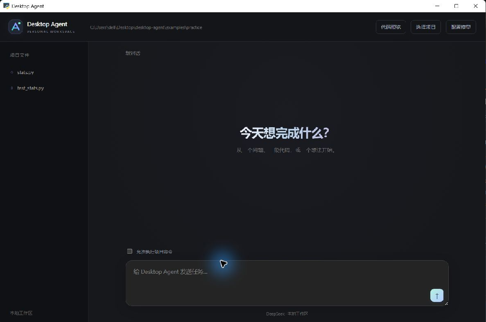
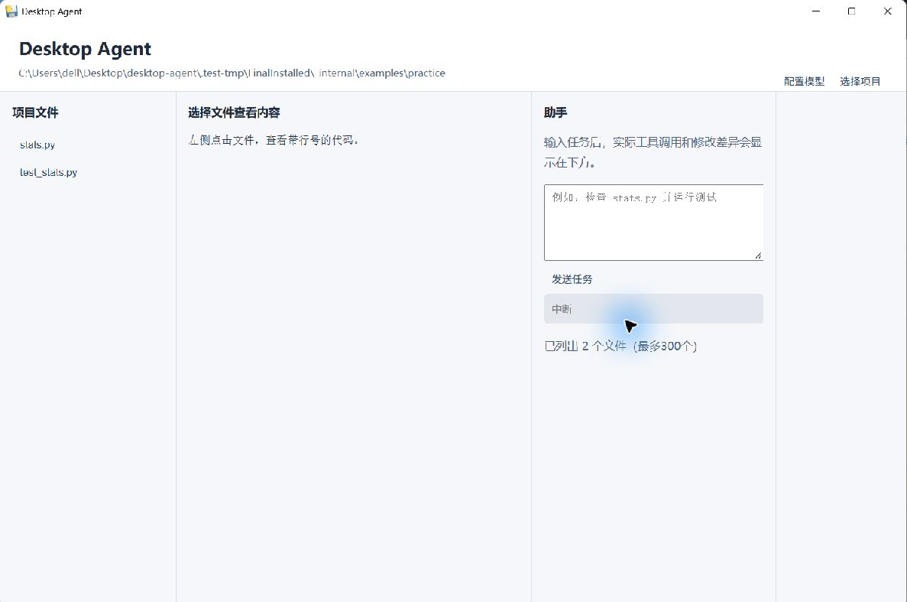
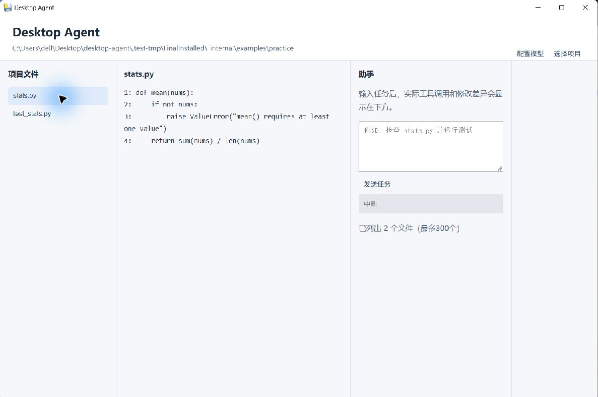
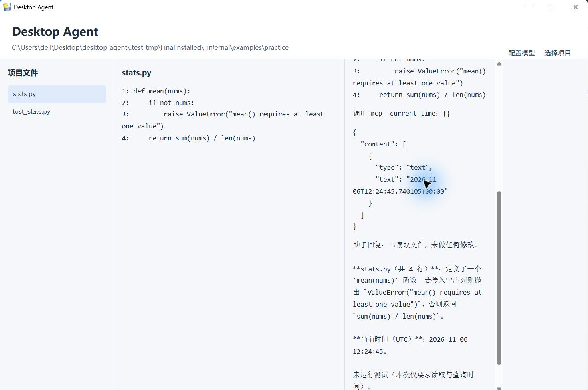

# Desktop Agent

当前版本 v1.0.2：彩色品牌标志、黑色工作台、可编辑代码区、保存与冲突保护。



Python + pywebview 桌面编程助手，AI 辅助开发。四个内置工具、模型循环、事件记录及独立 MCP 时间服务已接通。

## 三步使用

1. 从 Releases 下载并安装 Windows 安装包。
2. 双击 Desktop Agent，点击“配置模型”，在本地填入自己的 DeepSeek API Key。
3. 选择可信项目，输入需求并发送；右侧显示工具调用、diff、错误与最终回复。

需要 Windows WebView2 运行时，以及运行 Python 测试时项目所需的 Python 环境。账户需要可用 API 额度。

## 源码运行

```powershell
python -m pip install --target .desktop-deps -r requirements-desktop.txt
python desktop.py
```

模型配置读取项目 .env，打包后读取用户目录 DesktopAgent/.env。密钥不入库、不进入安装包。旧 app.py 是保留的 Tkinter 原型，正式入口是 desktop.py。

## 后端与验证

```powershell
python -m agent "读取文件并运行测试" --workspace "C:\可信项目"
python -m unittest discover -s tests -v
```

独立 SSE 后端：python -m server，启动时显示临时本地令牌；POST /run 输入 task 与 workspace，POST /cancel 请求中断。接口使用 Authorization: Bearer 加本地令牌。

18 项测试覆盖修改失败不写盘、分页、越界、编码、命令超时和中断、事件桥接、日志脱敏、MCP 独立进程和配置保存。真实失败恢复证据见 docs/trace.md。

## 工具与限制

read 按行读取、支持图片内容块；write 原子写；edit 唯一精确替换；bash 在 Windows 使用 PowerShell，有超时、截断和退出码。文件工具限制目录，但命令执行不是操作系统沙箱，只对可信项目使用。

MCP 示例由 mcp.json 配置，以独立进程运行，模型名称为 mcp__current_time。客户端仅支持教学所需 stdio 文本工具。

每次任务使用新的上下文；文本预览最多500行。网络请求最多60秒超时，中断期间不再执行新工具；暂不支持即时终止模型网络请求。

本地 .runs 记录不上传；分享前检查是否含项目私密信息。已配置的模型密钥会自动遮盖，其他凭据不能保证全部识别。

## 作业材料

report.md：架构与取舍。docs/trace.md：真实失败恢复。docs/build.md：构建方法。docs/development.md：真实开发记录。现场演示与视频需要使用实际安装版本录制。

## 安装版验收截图






## v1.0.2 编辑与完整案例

点击文件进入代码编辑区，直接输入内容后点击保存（或 Ctrl+S）。运行任务前需先保存。若文件已被其他操作修改，会拒绝覆盖并提示重新打开；任务运行时编辑器锁定。界面的“允许执行项目命令”默认关闭，开启后模型才可执行 bash/PowerShell 工具。

demo.mp4 已更新为彩色标志黑色安装版的完整案例：输入错误代码、保存、输入问题、模型真实读取并修复、查看 diff、独立验证结果。视频以真实关键操作帧按步骤展示，带中文说明，无配音，等待过程经过压缩，不是连续实时录屏。
